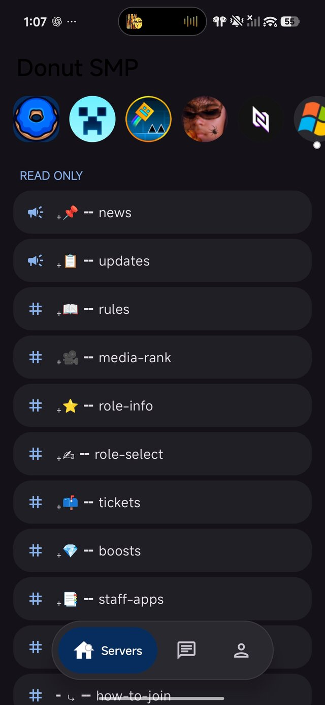
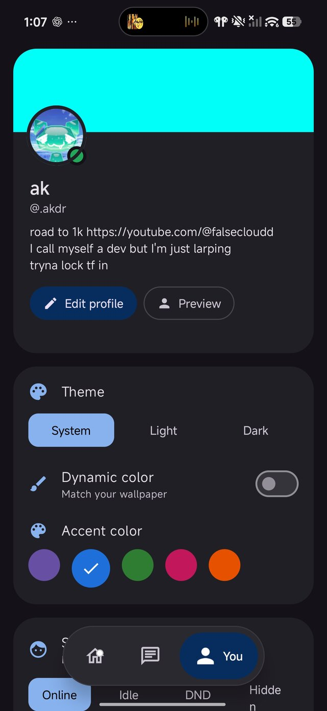
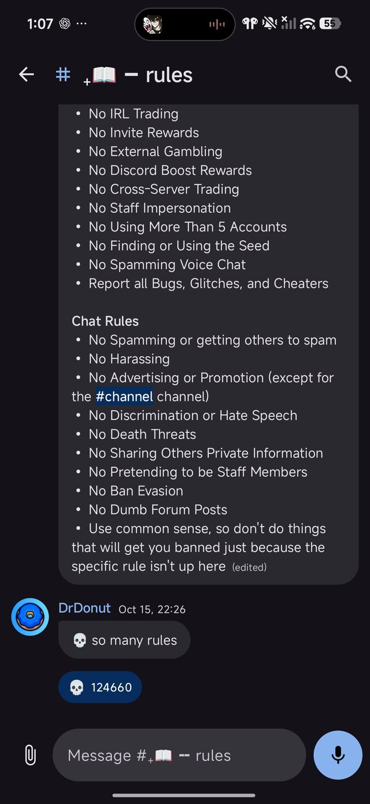

# M3w 🐱
*(pronounced "mew", like a cat meowing. Repo is still called `m3cord`, because we don't *paws* for renames.)*

A Material 3 Expressive Discord client (Kotlin + Compose) that's the cat's meow.

Formerly known as M3Cord. Same app, fur-ther improved.

## Screenshots
<table>
  <tr>
    <td align="center"></td>
    <td align="center"></td>
    <td align="center"></td>
  </tr>
  <tr>
    <td align="center">Servers &amp; channels claw-some navigation</td>
    <td align="center">Profile &amp; theme pick your purr-fect color</td>
    <td align="center">Chat nothing to hiss about</td>
  </tr>
</table>

## Get it
Grab the latest APK from the [Releases](../../releases) page and install it. It's a debug build, so there's no need to
be *feline* nervous. If you have an older copy signed with a different key, uninstall it first (Android won't update across keys).

## Build it yourself
Needs JDK 17 + Android SDK 35. Time to get your paws dirty:
1. `gradle wrapper --gradle-version 8.9`  (no wrapper jar included)
2. `./gradlew assembleDebug`
3. APK: `app/build/outputs/apk/debug/app-debug.apk`

If a dependency version fails to resolve, bump it to the nearest available one. No need to get your fur in a twist.
Material3 must be 1.4.0 or newer (Expressive APIs).

## What's new
- **New name and icon**: the app is now **M3w** (say it like a cat), with an adaptive icon of a very unimpressed face.
  The launcher label, login screen title and notification title all say M3w.
- **Active now** (Friends tab): a carousel of friends who are playing / listening / streaming, using the same Material 3
  multi-browse carousel pattern as Orion Store's "Recommended" section (masked rounded cards, copy fades as a card shrinks).
  Needs presence activities from the gateway (`Active.kt`, `Gateway.kt`); game art falls back to the app icon.
- **Emoji + GIF panel**: button next to the chat input opens a half-screen panel (`Emoji.kt`).
  - GIFs tab: Discord GIF search, trending, and your account's favorite GIFs (read/written through
    `/users/@me/settings-proto/2`, see `Proto.kt`). Heart any GIF in the panel, or long-press a message with a GIF -> "Favorite this GIF".
  - Emojis tab: custom emojis from every server you're in + all built-in Unicode emojis, with search and jump chips.
    Without Nitro, custom emojis are inserted as image links, like the official app.

## Contributing
Issues and PRs are welcome. Please don't be a scaredy-cat, and no need to be *purr-fect*.

---
*Meow you know. Thanks for stopping by.* 🐾
